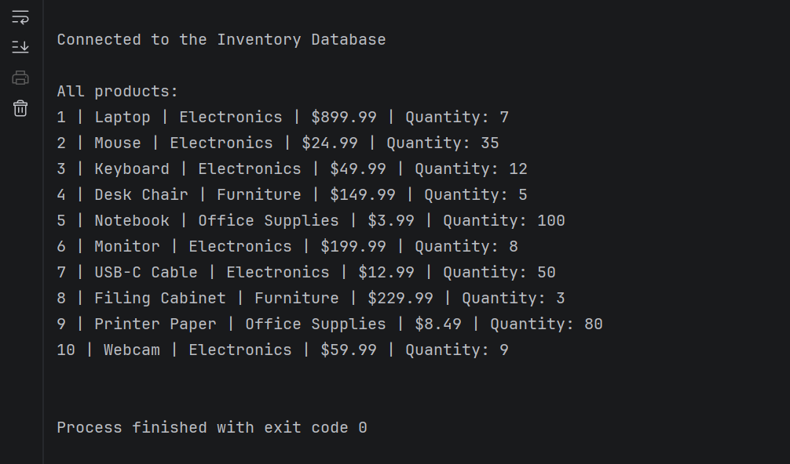
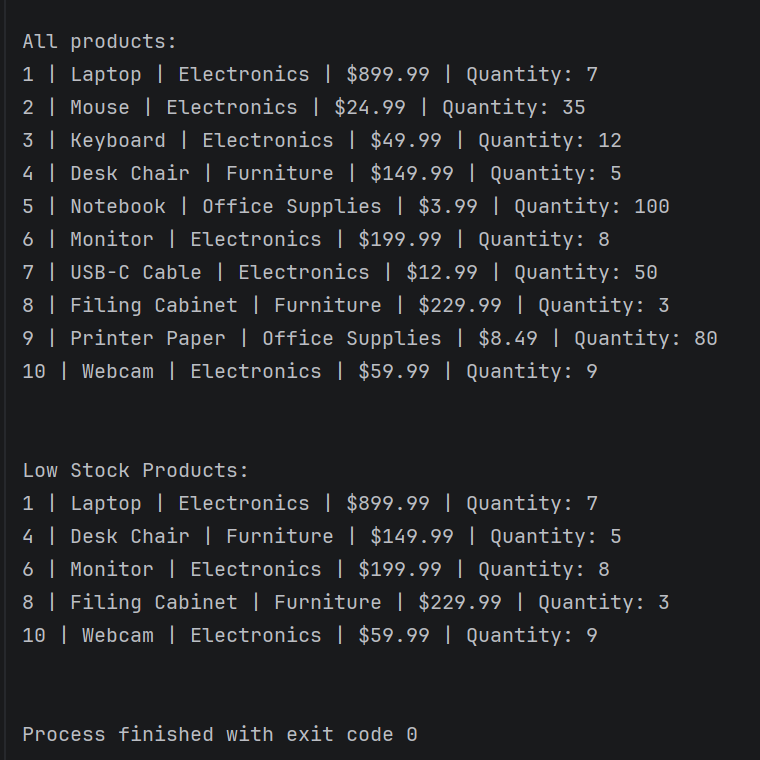
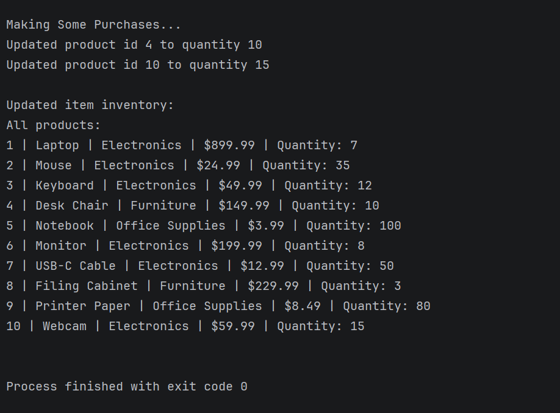
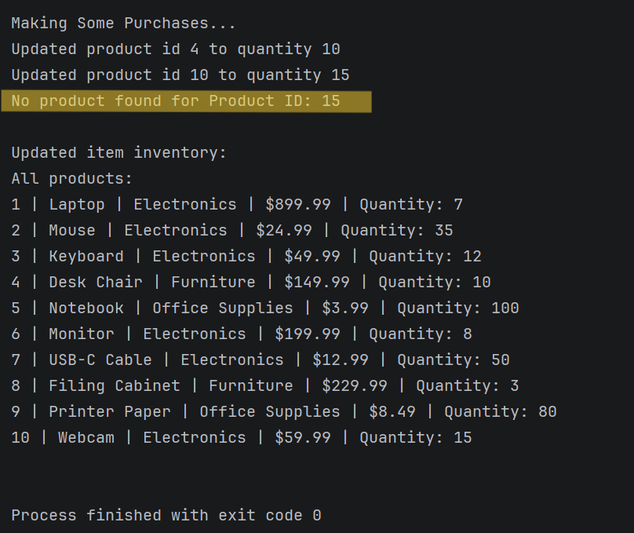

# Product Inventory Database

## Project Description

This Java program uses JDBC to connect to a local SQLite database named `inventory.db`. The program displays all products, identifies products with low stock, updates product quantities, and displays the updated inventory.

## How to Run

1. Open the project in IntelliJ. 
2. Make sure `inventory.db` and `sqlite-jdbc-3.54.1.0.jar` are located in the main project folder.
3. If needed, add `sqlite-jdbc-3.54.1.0.jar` as a library in IntelliJ so the SQLite JDBC driver is available to the project.
4. Open `src/InventoryDatabase.java`.
2. Run `InventoryDatabase.java`. 
3. View the database connection, product inventory, low-stock products, and updated quantities in the console.

## JDBC Driver

This project uses the SQLite JDBC driver:

`sqlite-jdbc-3.54.1.0.jar`

The driver allows the Java program to connect to the SQLite database using JDBC.

## Database

The program connects to:

`inventory.db`

The database contains product information including product ID, name, category, price, and quantity.

## Screenshots

### All Products

### Low Stock Products

### Updated Products

### Product Not Found

### Reflect
The program connects to the SQLite database file name `inventory.db`.
We did not create any tables, the products table already existed in `inventory.db`.
SQL Commands used: 
SELECT to display all products and filter low-stock.
UPDATE to change the product quantity of certain products (chosen by productID).
WHERE condition in the query for low-stock.
Prepared statements used for the database operations.
Most difficult part: JDBC setup to connect to the database.
Databases store information in an organized structure and can be queried to search/filter/update.
Text files (in contrast) are stored in plain text, so the program has to read and process the text information.
